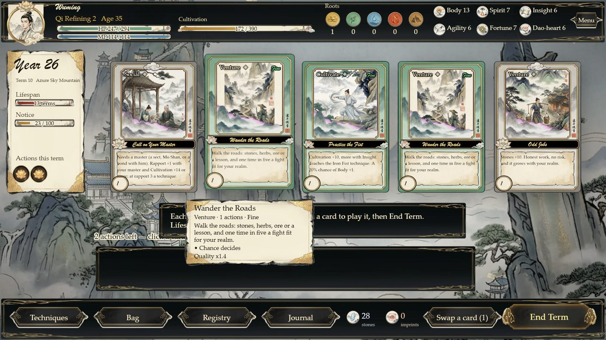
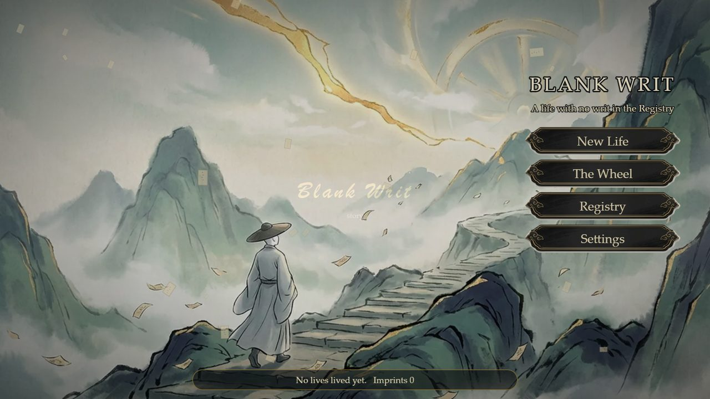
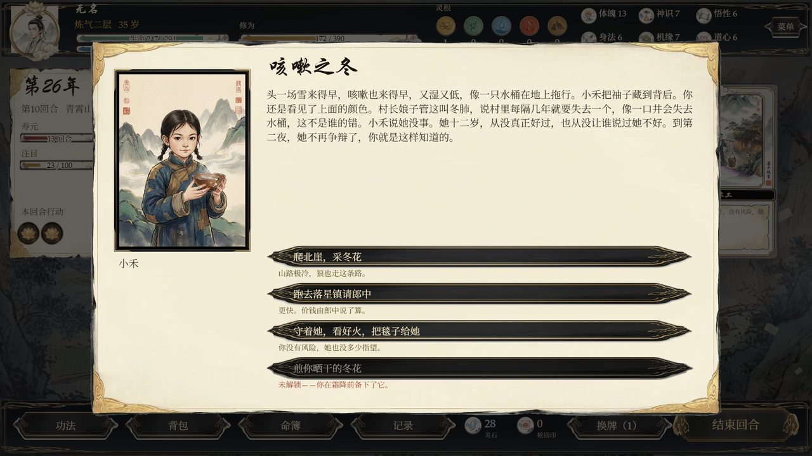
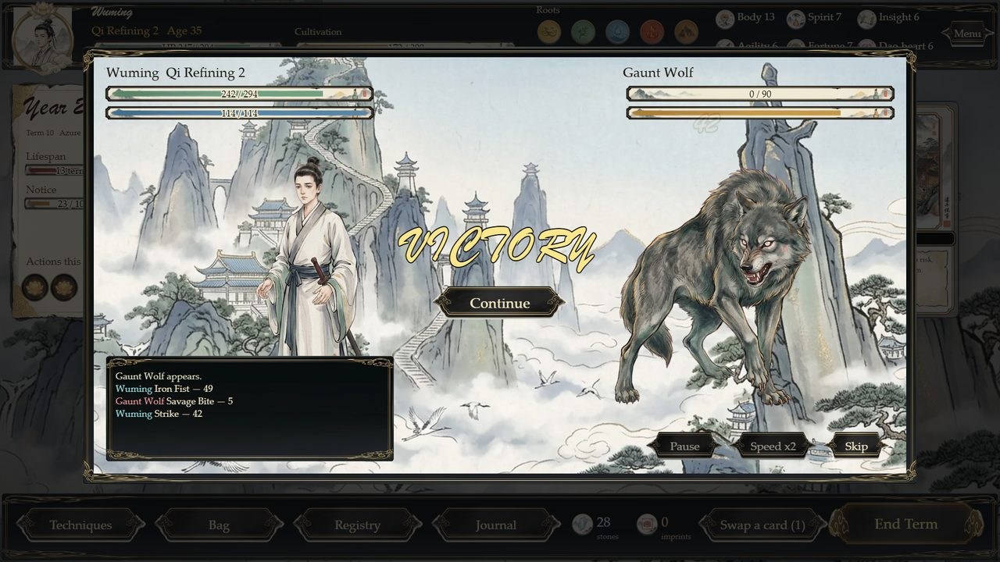
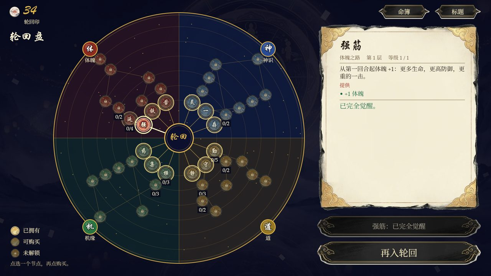

# Blank Writ · 无字命 (three.js)

**Play: <https://mitohacker.github.io/blank-writ-threejs/>**

A xianxia (修仙) action-card roguelite in the browser. You are the only soul in Dahuang with no writ in the Registry of Fate, so when you
die the Wheel cannot turn your page: you begin again, remembering a little more, and the Registry grows more interested in you every life.



* **Cards** - each term you draw a hand of five illustrated action cards (cultivate, craft, venture, social, rest, chance) and spend 2-3 actions.
  Card quality (plain / fine / rare / supreme) is rolled on draw. The hand is drawn in WebGL with three.js: cards lift and tilt toward the pointer.
* **Story** - a branching spine in four acts with 192 events, random events by realm, place and relationships, 12 torn pages of truth that open new
  choices in later lives, and five endings.
* **RPG stats** - Body, Spirit, Insight, Agility, Fortune, Dao-heart; five roots; realms from Mortal to Spirit Transformation with lifespan,
  breakthroughs and lethal tribulations.
* **Auto battle** - a deterministic gauge fight; you choose techniques, their order, pills and talismans.
* **Meta** - imprints (轮回印) bought on the Wheel between lives: stats, actions, hand size, lifespan, techniques, rewind, a head start.
* **Two languages, one at a time** - English / 中文 in Settings; only the chosen language is ever shown. Sound effects and music, volume and mute in Settings.
* Progress (profile, the Wheel, a life in progress) is saved in your browser's local storage.

| | |
|---|---|
|  |  |
|  |  |

## Controls

Click a card to play it (hover for details) · **End Term** · **Swap a card** · choose in events · **Esc** / Menu for the pause menu ·
Bag, Techniques, Registry, Journal along the bottom. Touch works the same way (tap a card).

## Run it locally

No build step; any static server works.

```
python serve.py 8712        # then open http://127.0.0.1:8712/
```

Query flags for testing: `?lang=zh`, `?fresh=1` (do not touch saved data), `?screen=term&autoplay=9&seed=77`, `?event=<id>`, `?battle=<enemy>`,
`?panel=bag|tech|journal|menu|shop|library`.

## Tests

```
npm install                         # playwright-core only (uses your installed Edge/Chrome)
node tests/test_sim.mjs             # the game logic against numbers dumped from the Godot original (245 checks)
node tools/bot_career.mjs 40 1      # a bot plays 40 lives: the career curve
node tests/browser/test_menus.mjs   # every menu screen, EN + ZH, real clicks
node tests/browser/test_term.mjs    # the term screen, cards, events, battles, overlays, EN + ZH, DOM fallback without WebGL
node tests/browser/test_flow.mjs    # title -> life -> death -> Wheel -> second life through the UI
node tests/browser/test_assets.mjs  # pictures exist (case-exact), sounds decode
```

## How it is built

A port of the Godot 4 prototype *Blank Writ* (same data, same rules). `src/sim/` is the game logic (plain ES modules, runs in Node and the
browser; names follow the GDScript), `src/ui/` the screens (DOM on a 1920x1080 stage scaled to fit), `src/gfx/` the three.js layer: the painted
place with a slow drift, mist and drifting paper talismans behind the stage, and the card hand. `src/audio.js` is WebAudio (effects) + HTML audio
(music with a crossfade). Content is JSON in `data/` (events in `data/events/`, Chinese tables in `data/i18n/`). `PORTING.md` has the rules of the port;
`python tools/build_assets.py` rebuilds the web assets from the Godot project.

Credits: all pictures were made with Tripo Studio image generation; sound effects and music are picked from Unity asset-pack libraries.
